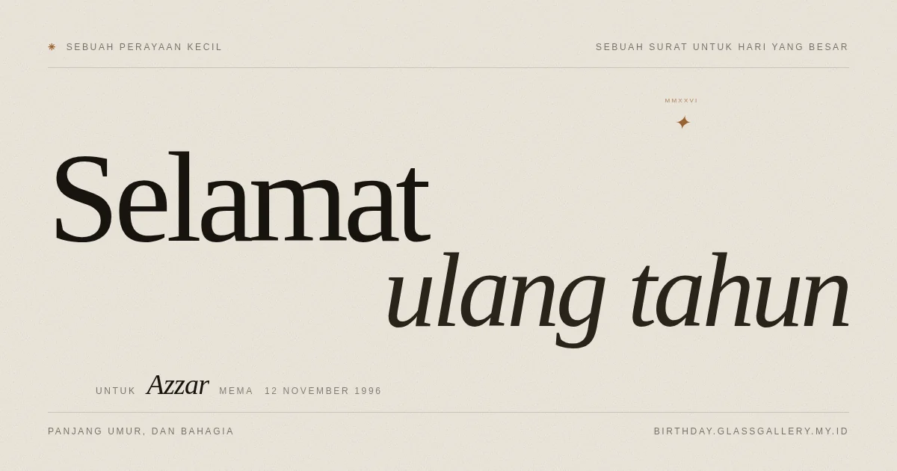

# Birthday Card

A birthday greeting you send as a link. The card is one page of static HTML; the name, the sign-off, and the date come from the URL.

**Live: <https://birthday.glassgallery.my.id>**


## Send it to someone

Add the person's details to the link. Nothing to install, nothing to rebuild.

```
https://birthday.glassgallery.my.id/?to=Azzar&from=Mema&date=1996-11-12
```

| Parameter | What changes |
| --- | --- |
| `to` | The name on the cover, the letter, and the closing line |
| `from` | Who the letter is from, in the sign-off |
| `date` | The birthday as `YYYY-MM-DD`; sets the date on the cover and the sign-off |

Everything else stays the same on every link: the letter, the five truths, the candle you light by holding it.

The preview image is rendered per recipient, so the card in a chat preview carries the same name:



Copy the link, paste it into WhatsApp or Instagram, and it reads like you wrote it for that person.

## What is in the card

- A cover set in Fraunces, with a rotating wax seal and a live clock in the recipient's timezone
- A letter on paper texture, with a wax seal that drops in when you reach it
- Five truths, pinned one after another on a horizontal scroll
- A candle you light by pressing and holding it
- A closing line, then a footer with the date

The whole page is one HTML file with no framework and no bundler. GSAP handles the motion, Lenis smooths the scroll, and both are served from the same origin as the site.

## Run your own copy

The card reads its content from the HTML, so you can change the words without touching the code.

```bash
git clone https://github.com/1999AZZAR/birthday-card.git
cd birthday-card
python3 -m http.server 8099 --directory site
```

Open <http://127.0.0.1:8099/>. Add `?to=Someone` to see the personalisation.

### Change the letter

The letter and the five truths are plain markup in `site/index.html` — the paragraphs are inside `.letter__sheet`, the truths are inside `.truths__track`. Edit them as you would any paragraph of text.

### Change the defaults

`site/assets/js/content.js` holds the values used when the URL has no parameters:

```js
window.BIRTHDAY = {
  to: "Kamu",
  from: "",
  date: "",        // empty means today
  city: "Jakarta",
  timeZone: "Asia/Jakarta",
};
```

### Change the colours and type

`site/assets/css/styles.css` keeps the palette in custom properties at the top of the file. The display face is Fraunces and the labels are Inter, both self-hosted in `site/assets/fonts/` so the card renders the same without a network.

## Deploy it

The site runs on Cloudflare Workers with static assets, and the preview image is drawn by Browser Run. The free plan is enough for a card like this: Workers allow 100,000 requests a day, and Browser Run allows ten minutes of browser time a day.

```bash
npm run deploy
```

That runs `scripts/build.mjs` and then `wrangler deploy`. The build step copies `site/` into `build/` and appends a content hash to every CSS and JavaScript URL, so the one-year immutable cache never serves a stale file.

You need a Cloudflare API token with **Account → Workers Scripts → Edit**, plus **Zone → Workers Routes → Edit** if you attach a custom domain. Set it as `CLOUDFLARE_API_TOKEN`.

To serve it from a container instead, `Dockerfile` builds the same `build/` output into nginx:

```bash
docker build -t birthday-card:latest .
```

## How the preview image works

`/og.png?to=Azzar&from=Mema` reads `site/og.html`, swaps the placeholders for the recipient's details, and hands the page to Browser Run at 1200×630. The Worker returns the PNG and caches it for that recipient for seven days.

Two limits come with the free plan. Browser Run allows one screenshot every ten seconds, so a second new recipient inside that window waits for the next slot instead of failing. And when the daily browser budget runs out, the endpoint falls back to the static `site/assets/img/og.png`, which is the same design without the name.

## Accessibility

- The letter and the truths are in the HTML, so they read without JavaScript.
- `prefers-reduced-motion` turns off the animation and releases the pinned section.
- The candle takes keyboard focus; hold `Enter` or `Space` to light it.
- Printing the page gives you the letter and nothing else.

## License

MIT. Use it, change the words, send it to whoever you like.
